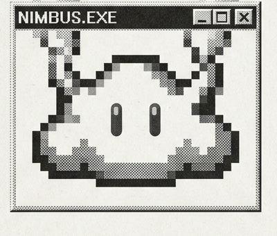

<p align="center"></p>

# Nimbus

**Your standing work, done every morning by an NVIDIA Nemotron 3 crew on Nebius Token Factory that routes every hop by cost, asks before it acts, and rewrites its own skill file.**

> **Quick Links for Judges**
> - **9-Clip Visual Tour (Real Nemotron 3 Runs):** https://nimbus-production-6f7b.up.railway.app/welcome
> - **Live App (Real Nebius Token Factory Inference):** https://nimbus-production-6f7b.up.railway.app
> - **Demo Video (2:40, 100% Real-Model Take):** https://www.youtube.com/watch?v=obMWKCewVTY
> - **Slide Deck (PDF & HTML):** [docs/posters/nimbus-deck.pdf](docs/posters/nimbus-deck.pdf) · [docs/posters/nimbus-deck.html](docs/posters/nimbus-deck.html)
> - **License:** [MIT License](LICENSE) (OSI Approved)

Every morning I read my inbox, my calendar, and GitHub notifications before I have done any real work, then write the same kinds of replies I wrote yesterday. **Nimbus** is a personal operations room that runs that standing work with a six-role crew of **NVIDIA Nemotron 3** agents (`Ultra 550B`, `Super 120B`, and `Nano 30B`) on **Nebius Token Factory**.

Built from scratch during the **Nebius × NVIDIA Global AI Hackathon** (Personal AI track, started October 27, 2026).

## Three doors to the same crew

One crew, one timeline, one set of rules: start a run, approve it and read it from whichever door is closest.

- **Web: the ops room** ([live app](https://nimbus-production-6f7b.up.railway.app)). Every agent, every step and every cent on one live timeline, with the approval cards, the memories and the rewritten `SKILL.md` beside it. Proof: the production Checkout run [`run_668c7252`](https://nimbus-production-6f7b.up.railway.app/?run=run_668c7252) shows its three `run_code` calls with the **Nebius Sandbox** chip ([walkthrough](#quick-walkthrough-for-judges), [docs/SANDBOX.md](docs/SANDBOX.md)).
- **Phone: Telegram.** Nimbus reads its own bot, so `/run morning brief` becomes one progress message edited in place, and approvals and crew questions arrive as buttons (**Approve · Always allow · Reject**) that the web timeline records as `via telegram`. Mock-tested 40/40 with `pnpm check:telegram`; the real run from a phone is pending ([docs/TELEGRAM.md](docs/TELEGRAM.md)).
- **Terminal and coding agent: `nimbus` and `nimbus mcp`.** `pnpm nimbus run checkout` follows a run as text and asks for the plan, each approval and each question in the terminal, and `nimbus mcp` lets Claude Code, Cursor, OpenClaw or Hermes do the same over MCP. `nimbus doctor` is green against production; the CLI and MCP server are mock-tested 36/36 with `pnpm check:cli`, and the real Claude Code run is pending ([docs/CLI.md](docs/CLI.md)).

---

## Setup & Run Instructions (Full to Running in 2 Minutes)

**Prerequisites:** Node.js `>= 20` and `pnpm` (`corepack enable pnpm` or `npm i -g pnpm`).

### Mode A: Zero-Key Judge Mode (Runs Out of the Box at $0)

You can clone and run the entire application, all seven workstreams, the cost router, approval gates, and the 19-golden evaluation suite **without any API keys**. When `NEBIUS_API_KEY` is empty, Nimbus automatically falls back to a deterministic scripted mock model (`NIMBUS_MODEL=mock`).

```bash
git clone https://github.com/harrymove-ctrl/nimbus.git
cd nimbus
pnpm install
cp .env.example .env.local        # leave API keys empty for zero-key mock mode
pnpm dev                          # opens http://localhost:3000 (landing tour at /welcome)
```

In a second terminal, you can run the headless demo or verification suites immediately:

```bash
pnpm demo                         # headless run of the demo workstream, prints token usage and cost
pnpm demo:router                  # tests router savings, 429/404 tier fallback, and response cache
pnpm eval --cheap                 # runs all 19 trajectory goldens (145 per-hop assertions)
```

### Mode B: Live NVIDIA Nemotron 3 on Nebius Token Factory + Tavily Search

To run against live **NVIDIA Nemotron 3** models (`Ultra`, `Super`, `Nano`) on **Nebius Token Factory** and live **Tavily** web search, add your keys to `.env.local`:

```bash
# .env.local
NIMBUS_MODEL=nebius
NEBIUS_API_KEY=your_nebius_token_factory_api_key
NEBIUS_BASE_URL=https://api.tokenfactory.nebius.com/v1
TAVILY_API_KEY=your_tavily_api_key
```

Then verify live connectivity across all three Nemotron 3 tiers and start the server:

```bash
pnpm smoke                        # verifies live Ultra, Super, and Nano tool calling on Token Factory
pnpm dev                          # runs live Nemotron 3 agents at http://localhost:3000
```

### Mode C: Docker & Nebius Serverless Endpoints / Jobs

Nimbus ships with a production `Dockerfile` and a headless CLI job runner (`pnpm run:job`) for scheduled **Nebius Serverless Jobs** and **Nebius Serverless Endpoints** (full commands in [docs/deploy.md](docs/deploy.md)):

```bash
# Run a scheduled workstream headlessly as a batch job
pnpm run:job --workstream ws-radar --yes

# Or build and run the production container locally
docker build -t nimbus:latest .
docker run --rm -p 3000:3000 --env-file .env.local -v "$(pwd)/data:/app/data" nimbus:latest
```

---

## Quick Walkthrough for Judges

1. **Overview (`/`)**: Opens with today's spend against the daily cap, runs completed, approvals waiting, memories learned, 7-day stacked spend by Nemotron tier, tokens by tier, an 8-week runs calendar, and router savings. The left rail has 7 workstreams, and **Hackathon radar** already has a finished 09:00 run waiting with an unread dot.
2. **Morning Brief (`ws-brief`)**: Click **Morning brief** in the left rail, pick a goal chip, and press **RUN**.
   - **Editable Plan Draft**: `Nemotron 3 Ultra` proposes a step-by-step plan. You can edit, reorder, or add steps before clicking **Approve plan**.
   - **Live Multi-Agent Timeline**: Watch `Orchestrator (Ultra)`, `Researcher (Super)`, `Writer (Super)`, `Checker (Nano)`, and `Learner (Nano)` execute across parallel lanes with model badges and live Nebius token pricing on every segment.
   - **Approval Cards That Compile Into Rules**: The crew reads `fixtures/inbox/*.eml`, `fixtures/calendar.ics`, and `fixtures/github-notifications.json`, writes a one-page brief, and drafts three replies (client, teammate, reviewer). Nothing is sent without your approval. On the reviewer's card, click **Approve & always allow**: Nimbus writes `allow: send_message to reviewer@example.com` into the workstream's `SKILL.md`.
   - **Self-Rewriting Skill & Run 2 Savings**: After the run, the `Learner` on `Nemotron 3 Nano` saves 8 memories and rewrites `SKILL.md` (with a full diff and a **Revert skill change** button). Run **Morning brief** a second time: it starts with what Run 1 learned, sends the reviewer reply automatically under the saved rule with no card, and costs less (`$0.0216` on Run 1 down to `$0.0209` on Run 2).
3. **Ship Nimbus (`ws-ship`)**: The crew runs `pnpm eval` and `pnpm typecheck` against this repository in a sandboxed subprocess, reproduces failing router goldens, writes a unified diff patch, verifies the fix, and waits for your approval before opening a GitHub PR.

---

## From your phone (Telegram)

Nimbus runs its own Telegram bot: send `/run morning brief` and one message follows the crew lane by lane, approvals arrive as cards with **Approve · Always allow · Reject**, crew questions arrive with their options as buttons, and scheduled runs message you first. Every decision appears on the web timeline as `via telegram`. Setup (BotFather token, `/start` to learn your chat id, `NIMBUS_TELEGRAM_CHAT_ID`): [docs/TELEGRAM.md](docs/TELEGRAM.md). Mock test: `pnpm check:telegram`.

## How We Used NVIDIA Nemotron 3 & Open-Source Models

Nimbus uses **all three tiers of the NVIDIA Nemotron 3 family** plus open-source embeddings on **Nebius Token Factory** (`src/lib/models.ts` and `src/lib/tokenfactory.ts`), matching each agent role to the smallest model tier that can reliably execute its job:

| Tier | Nebius Token Factory Model ID | Assigned Crew Roles | Token Factory Price (In / Out per 1M) | Why We Chose This Variant |
| :--- | :--- | :--- | :--- | :--- |
| **Ultra** | `nvidia/Nemotron-3-Ultra-550b-a55b` | **Orchestrator** | `$1.00` / `$3.00` | Runs 1 to 2 times per job to decompose the user's goal into an editable plan, coordinate handoffs, and frame human approval requests where deep reasoning matters most. |
| **Super** | `nvidia/nemotron-3-super-120b-a12b` | **Researcher, Analyst, Writer** | `$0.30` / `$0.90` | 256K context window handles multi-file inbox threads, calendar `.ics` files, GitHub payloads, Tavily web search results, and code diffs at under one third the cost of Ultra. |
| **Nano** | `nvidia/NVIDIA-Nemotron-3-Nano-30B-A3B` | **Checker, Learner, Router Classifier** | `$0.06` / `$0.24` | Costs **1/16th of Ultra** per input token. Ideal for high-frequency verification gates, step classification, memory extraction, and rewriting `SKILL.md` after every run. |
| **Embed** | `BAAI/bge-en-icl` | **Memory Recall Engine** | `$0.01` / `$0.00` | Open-source embedding model on Token Factory used for top-k semantic recall of learned workstream memories (`src/runtime/memory.ts`). |

### Measured Real-Model Numbers on Nebius Token Factory (Oct 29, 2026)

Every clip in our 2:40 demo video and `/welcome` tour comes from real runs against live NVIDIA Nemotron 3 models on Nebius Token Factory (full run logs and commit SHAs in [docs/video/RELEASE.md](docs/video/RELEASE.md)):

| Real Run ID | Workstream & Scenario | Total Cost | Tokens | Calls (Model / Tool) | Cost-Router Savings vs. Ceiling | Outcome |
| :--- | :--- | :--- | :--- | :--- | :--- | :--- |
| `run_724b8d9d` | **Morning Brief (Morning 1)** | **`$0.0216`** | `58,950` | `23` / `21` | **24% saved** (vs. `$0.0283` ceiling) | 3 approval cards, 1 `allow:` rule saved, 8 memories written, `SKILL.md` rewritten |
| `run_915dfc1d` | **Morning Brief (Morning 2)** | **`$0.0209`** | `57,015` | `20` / `18` | **27% saved** (vs. `$0.0287` ceiling) | **3% cheaper** than Run 1, reviewer reply auto-sent under saved rule (0 cards), **16 memories** held |
| `run_6b393ab6` | **Live `/v1/chat/completions` Run** | **`$0.0282`** | `76,827` | `23` / `20` | Routed across Ultra, Super, Nano | Triggered and approved end-to-end via the OpenClaw / Hermes `/v1` API on Railway |

---

## Where Nebius Token Factory & Nebius Ecosystem Tools Accelerated Our Workflow

1. **Unified OpenAI-Compatible Inference Across Three Model Sizes (`Nebius Token Factory`)**:
   Pointing the Vercel AI SDK (`@ai-sdk/openai`) at a single base URL (`https://api.tokenfactory.nebius.com/v1` in `src/lib/tokenfactory.ts`) gave us immediate access to `Ultra 550B`, `Super 120B`, `Nano 30B`, and `BAAI/bge-en-icl` with zero GPU provisioning. Switching an agent hop between a 550B planner and a 30B verifier is a single model string change in `src/runtime/router.ts`, and automatic tier fallback (`Ultra → Super → Nano`) on `429`, `5xx`, or timeout kept multi-agent runs resilient.
2. **Transparent Per-Token Pricing & Cached-Input Prefixes (`Nebius Token Factory`)**:
   Because Token Factory exposes clear per-tier input, cached-input, and output pricing (`$0.06` to `$3.00` per 1M tokens) plus a public catalog endpoint (`/api/public/models_info`), Nimbus calculates exact dollar spend per agent call in real time, enforces hard per-run (`NIMBUS_RUN_CAP_USD`) and daily (`NIMBUS_DAY_CAP_USD`) spend caps, and includes a **Token Factory Watch** workstream (`ws-watch`) that audits its own 7-day SQLite call log against the live Token Factory catalog to propose cheaper routing rules.
3. **Grounded Web Search for the Researcher Agent (`Tavily`, a Nebius Company)**:
   Integrating `@tavily/core` into the Researcher agent's `web_search` tool (`src/runtime/tools.ts`) took 15 lines of code. When `TAVILY_API_KEY` is present, the Researcher queries the live Tavily API (`maxResults: 5, includeAnswer: true`) for grounded citations during competitor and release research, and cleanly falls back to local JSON fixtures (`fixtures/search/*.json`) in zero-key offline mode.
4. **Containerized App & Batch Cron Runner (`Nebius Serverless Endpoints & Jobs`)**:
   We structured Nimbus with a self-contained multi-stage `Dockerfile`, persistent SQLite volume (`/app/data`), and a headless CLI runner (`pnpm run:job --workstream <id> --yes` in `scripts/run-job.ts` and `docs/deploy.md`) so the exact same codebase runs as an interactive web console on a Serverless Endpoint or as a scheduled batch job.
5. **Drop-In Bridge for the NVIDIA Agent Ecosystem (`OpenClaw`, `Hermes Agent`, `NemoClaw`, `OpenShell`)**:
   Nimbus exposes an OpenAI-compatible `POST /v1/chat/completions` endpoint (`src/app/api/v1/chat/completions/route.ts` and [docs/openclaw.md](docs/openclaw.md)) with SSE streaming, bearer auth, and outbound Telegram notifications (`src/lib/telegram.ts`). You can point OpenClaw or Hermes Agent at Nimbus in 10 lines of config to ask `"what needs me?"` or `"approve"` from your phone while keeping one unified timeline and audit log.

---

## Nebius Token Factory Sandboxes (Beta)

Set `NEBIUS_PROJECT_ID` next to `NEBIUS_API_KEY` and the crew's `run_code` tool stops running model-written code on your machine: each call uploads the script and the attached files to `https://api.tokenfactory.nebius.com/sandboxes/v1`, spawns one disposable VM with networking off, polls the operation and brings back stdout, stderr and the exit code. Agent I/O marks the call with a **Nebius Sandbox** chip (image, elapsed time, operation id). Without the project id, or if the sandbox call fails, the same code runs as a local subprocess and the result says so. Design notes: [docs/SANDBOX.md](docs/SANDBOX.md).

**On production.** Checkout [`run_668c7252`](https://nimbus-production-6f7b.up.railway.app/?run=run_668c7252) ($0.009, 51 s) made three `run_code` calls on `data.csv` and `inbox.csv`, each in its own Nebius VM: 4.9, 3.5 and 3.5 s per call end to end, of which 0.63, 0.75 and 0.71 s ran inside the VM (all from the run's events).

**An image with pandas.** The public catalog has `python:3.12-slim` and `node:20-slim` but no data-science image, so production imports `amancevice/pandas:slim` once (`POST /images/import`, about 17 s the first time) and sets `NIMBUS_SANDBOX_IMAGE_PYTHON` to the returned UUID. Spawning by that UUID takes about 3.6 s, the same as `python:3.12-slim`, with pandas 3.0 and numpy 2.5. UUIDs are per project, so import your own, and keep the UUID in the environment: the imported image does not show under `GET /images?tag=`.

Turn it on in four steps:

1. Open [tokenfactory.nebius.com](https://tokenfactory.nebius.com), pick your project and go to **API keys**. The **Project id** (`aiproject-...`) is shown above the keys. Sandboxes is in beta: request access once from the Sandboxes page; the same key then works for models and sandboxes.
2. Add `NEBIUS_PROJECT_ID=aiproject-...` under `NEBIUS_API_KEY` in `.env.local`.
3. Run `pnpm sandbox:probe`. It prints who the key is, the image catalog and one real run that reads an uploaded CSV. Expected last lines: `run: SUCCESS exit 0` and `stdout: ok ...`.
4. Hosted: `railway variables --service nimbus --set NEBIUS_PROJECT_ID=aiproject-...` and redeploy. Start any workstream with `run_code` (Checkout, Audit, Ship Nimbus) and open Agent I/O: the tool call shows the **Nebius Sandbox** chip.

Measured with `pnpm sandbox:probe` on 2026-10-29: `python:3.12-slim` and `node:20-slim` runs complete in about 3 s end to end (under 0.1 s of execution inside the sandbox); the beta allows 50 concurrent instances and a 3600 s timeout. What comes next for Sandboxes is in [Where this goes](#where-this-goes).

## What Real Nemotron 3 Models Taught Us Beyond the Mock (7 Engineering Fixes)

Running 198 live calls across six recording takes (`$0.49` total on Nebius Token Factory) exposed seven real multi-agent behaviors that our scripted mock never triggered:

1. **Thinking Tokens Starving `Nano 30B` (`src/runtime/learner.ts`, commit `23f32be`)**: With `<think>` enabled by default, `Nemotron-3-Nano-30B-A3B` spent its entire 600 to 1,500 `max_tokens` budget inside `<think>` blocks and exited before emitting the `save_learning` tool call. Passing `chat_template_kwargs: { enable_thinking: false }` cut Learner output from `690+` tokens to `102` tokens (`$0.0005`), saving 8 memories and rewriting `SKILL.md` reliably on every run.
2. **Child Agents Burning All Turns on Reads (`src/runtime/agent.ts`, commit `be3ddc0`)**: On live models, the Researcher called `read_repo` once per file across 8 turns and hit the turn cap before writing its report. We raised child turn budgets to 12 and added a tool-free final synthesis turn when an agent hits the limit with no summary.
3. **Orchestrator Handoff Placeholders (`src/runtime/orchestrator.ts`, commit `3e117e6`)**: `Ultra` sometimes passed `"Draft the brief (include the Researcher's report)"` instead of copying the full report text, forcing the Writer to re-read every raw file. The runtime bus now automatically attaches completed crew reports to every downstream `spawn_agent` call.
4. **Declaring Source Paths Upfront (`src/lib/workstreams.ts`)**: Live `Researcher` agents initially paused to ask where the inbox lived; declaring exact paths (`fixtures/inbox/*.eml`, `fixtures/calendar.ics`, `fixtures/github-notifications.json`) in the initial `SKILL.md` eliminated the extra round-trip.
5. **Triggering Approval Cards via Tool Calls (`src/lib/workstreams.ts`)**: The `Writer` initially wrote reply text inside the brief markdown without calling `send_message`, producing zero approval cards. Instructing the Writer that `send_message` itself triggers the human approval gate fixed it immediately.
6. **Preventing PR Status Hallucinations (`src/lib/workstreams.ts`, commit `f9a0be7`)**: In an early live run, a drafted reply claimed a PR fix *"has shipped"* when `github-notifications.json` showed it was still in review. Tightening source-grounding rules across the Writer and Checker eliminated status drift.
7. **Normalizing Rule Keys Across Runs (`src/runtime/agent.ts`)**: Normalizing `send_message` arguments (`{ to, body }` and `{ channel, text }`) ensured that `allow: send_message to reviewer@example.com` saved in Run 1 matched automatically on Run 2 with zero friction.

---

## From your terminal and your coding agent (CLI and MCP)

`pnpm nimbus …` (or `npx nimbus …` in the repo) drives a running Nimbus over its HTTP API: `nimbus doctor` checks the
keys, Sandboxes, Telegram and the day cap; `nimbus run checkout` follows a run as text and asks for the plan, each
approval and each question in the terminal; `nimbus status`, `approve`, `reject "note"` and `ws export|import` (YAML)
do the rest. `nimbus mcp` is a stdio MCP server, so Claude Code, Cursor, OpenClaw or Hermes can start a run, wait for
its approval, approve it and read the artifact (`pnpm nimbus mcp install claude --write`). Every command, the tool
table and the client snippets: [docs/CLI.md](docs/CLI.md). Test: `pnpm check:cli` (mock, $0).

## Architecture

```mermaid
flowchart LR
  U([You]) -->|goal, steer, answer, approve| UI[Overview · Run View<br/>Timeline · Transcript · Inspector]
  UI <-->|SSE events + POST| API[Next.js 15 API Routes]
  CHAT[OpenClaw / Hermes] -->|/v1/chat/completions| API
  CRON[node-cron · pnpm run:job] --> API
  API --> RT[Runtime<br/>Bus · Agent Loop · Orchestrator]
  RT --> R{3-Tier Cost Router<br/>Rules → Nano Classifier<br/>Retry → One Tier Down}
  R -->|Ultra · Super · Nano| TF[(Nebius Token Factory<br/>Nemotron 3 550B / 120B / 30B)]
  R -.->|no API key| MOCK[Scripted Mock Model]
  RT --> T[Tools: web_search (Tavily) · fetch_url · run_code · read_repo · write_artifact · send_message · open_pr]
  RT --> DB[(SQLite · libsql + Drizzle<br/>events · artifacts · memories · skills · llm_cache)]
```

### Key Surfaces in the App

| Surface | What It Does |
| :--- | :--- |
| **Overview** | Seven live SQLite regions (stat cards, 7-day stacked spend by tier, tokens by tier, 8-week runs calendar, scheduled health, router savings, impact line). |
| **Plan Draft & Checklist** | The Orchestrator's plan is editable until you approve it, then becomes a live checklist that collapses when complete. |
| **Multi-Agent Timeline** | One lane per agent with its Nemotron tier badge and cost; click any segment to trace handoffs or replay a finished run at `0.5×`, `1×`, or `2×`. |
| **Agent I/O & Loop Inspector** | Inspects every hop as three stations (**Gather**, **Act**, **Verify**) including failed commands and retry loops. |
| **Status Pill** | Tracks background runs in the top bar with inline **Pause**, **Stop**, **Open run**, **Approve**, and **Deny**. |
| **Memory & Skill Inspector** | Displays active `allow:` rules (with one-click **Revoke**), the workstream's `SKILL.md` (with diff view and **Revert**), and learned memories (with **Forget**). |

---

## Verification & Evaluation Commands

| Command | What It Verifies |
| :--- | :--- |
| `pnpm smoke` | **Live Nebius Token Factory check:** verifies `Ultra`, `Super`, and `Nano` responses and tool calling (requires `NEBIUS_API_KEY`). |
| `pnpm demo` | Headless run of the demo workstream: `>= 3` concurrent agents, markdown artifact, approval gate, usage, and cost. |
| `pnpm demo:router` | Verifies cost with router `on` vs `off`, forced `429` and `404` falling one tier down to `Nano`, and `$0` cache hits. |
| `pnpm eval [--cheap] [--ab]` | Runs all **19 trajectory goldens (145 per-hop assertions)** and writes `evals/report.json` (`-47.9%` routed spend in `--ab` mode). |
| `pnpm check:cases` | End-to-end verification of all 6 core workstreams (`ship`, `radar`, `brief`, `audit`, `watch`, `release`). |
| `pnpm check:tools` | Verifies `read_repo` read-only guards, `run_code` allow-listed sandbox execution, and `open_pr` safety gates. |
| `pnpm check:rules` | Verifies that approving a `Token Factory watch` router proposal updates `data/router-rules.json` and reduces run spend by `15.3%`. |
| `pnpm check:learning` | Verifies Memory & Skill tab APIs: rule revocation, `SKILL.md` revert, and memory deletion. |
| `pnpm check:loop` | Verifies that Run 2's prompt injects Run 1's memories and updated `SKILL.md`, and honors saved `allow:` rules. |
| `pnpm check:budget` | Verifies per-run cap (`NIMBUS_RUN_CAP_USD`), daily cap (`NIMBUS_DAY_CAP_USD`), and zero-cost `NIMBUS_REPLAY` fidelity. |
| `pnpm check:chat` | Verifies the OpenClaw / Hermes `POST /v1/chat/completions` bridge (`status`, `approve`, `deny`, `answer`, `run`) and Telegram alerts. |
| `pnpm check:telegram` | Verifies the Nimbus Telegram bot against a stub Bot API: privacy, `/run` with one edited progress message, three-button approval cards, question buttons, scheduled pushes, `/status`, one poller per database. |

---

## Environment Variables (`.env.example`)

| Variable | Purpose |
| :--- | :--- |
| `NIMBUS_MODEL` | `mock` or `nebius` (default: `nebius` when `NEBIUS_API_KEY` is set, otherwise `mock` at `$0`). |
| `NEBIUS_API_KEY` | Your Nebius Token Factory API key (`https://tokenfactory.nebius.com`). |
| `NEBIUS_BASE_URL` | Nebius Token Factory endpoint (`https://api.tokenfactory.nebius.com/v1`). |
| `TAVILY_API_KEY` | Live Tavily API key for the Researcher's `web_search` tool (falls back to `fixtures/search/*.json` when unset). |
| `NIMBUS_ROUTER` | `on` (default 3-tier cost routing) or `off` (pins every hop to its role's ceiling tier). |
| `NIMBUS_RUN_CAP_USD` | Hard per-run spend ceiling in USD (default `0.25`). Stops the run cleanly with a `Cap hit` badge if exceeded. |
| `NIMBUS_DAY_CAP_USD` | Hard daily real-model spend ceiling in USD (default `5.00`). Mock runs do not count against the cap. |
| `NIMBUS_API_TOKEN` | Bearer token for `POST /v1/chat/completions` (OpenClaw / Hermes bridge). |
| `NIMBUS_TELEGRAM_BOT_TOKEN`, `NIMBUS_TELEGRAM_CHAT_ID` | Optional outbound Telegram bot notifications when a background run needs approval or finishes. |
| `NIMBUS_DATA_DIR` | Directory for the SQLite database (`nimbus.db`) and run workspaces (default `./data`). |

---

## Tech Stack

Next.js 15 (App Router), React 19, TypeScript, Tailwind CSS v4, shadcn/ui, React Bits Pro (Sorbet), [dithercn](https://dithercn.dev) (Bayer-8 ordered dither charts and backgrounds), Vercel AI SDK (`@ai-sdk/openai`), Nebius Token Factory (`Nemotron 3 Ultra / Super / Nano` + `BAAI/bge-en-icl`), Tavily Search (`@tavily/core`), SQLite (`@libsql/client` + Drizzle ORM), `node-cron`, Playwright, and Remotion.

Additional documentation: [docs/SUBMISSION.md](docs/SUBMISSION.md) · [docs/video/RELEASE.md](docs/video/RELEASE.md) · [docs/deploy.md](docs/deploy.md) · [docs/openclaw.md](docs/openclaw.md) · [docs/CASES.md](docs/CASES.md) · [docs/SPEC.md](docs/SPEC.md).

## Where this goes

Lane 2 of [docs/ROADMAP.md](docs/ROADMAP.md), the open-source future after the hackathon:

- **MCP both ways.** Nimbus as an MCP client too: you list your own servers (Gmail, Calendar, GitHub, Notion, Linear) and the crew gets their tools behind the same approval cards and always-allow rules, which retires the fixture `send_message`.
- **Sandbox-first execution.** Ship Nimbus runs its evals inside a Nebius Sandbox on a clone of the repo, each workstream names its own image (imported once, UUID pinned), the crew's charts and CSVs come back out as artifacts, and one sandbox serves every step of a run.
- **More doors on one intent router.** Webhook Telegram with voice notes, then Discord and Slack, with group chats and per-person allowlists.
- **Multi-user and one-line self-host.** Accounts with per-user data and day caps for a household or a class, `docker compose up` plus `nimbus init`, and a GitHub Action that runs a workstream on a schedule for people without a server.
- **Crews people share.** `nimbus ws export` folders (workstream YAML, `SKILL.md`, memories by opt-in), a `community/` templates folder whose CI runs every template in mock mode, and a run exported as one `.nimbus.json` anyone can open.
- **Release discipline and local models.** `pnpm eval` on every PR, a nightly real-model canary under a cap, semver releases with a changelog, and an `ollama` provider so the Checker and Learner can run on a laptop while Nebius stays the default for Ultra and Super.

## License

Released under the OSI-approved **MIT License**. See [LICENSE](LICENSE) for full text.
