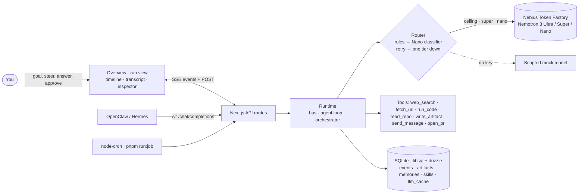

# Nimbus

A glowing cloud that runs your ongoing work with a crew of NVIDIA Nemotron agents,
asks before it acts, and learns from every run.

Built for the Nebius x NVIDIA Global AI Hackathon (Personal AI track). Started 2026-10-27 as a new project.

> **Status, stated plainly.** Everything below runs today with **no API keys** against a scripted
> *mock model*. The real Nemotron / Token Factory path is written but has **not been run yet**:
> `pnpm smoke` (the one command that needs `NEBIUS_API_KEY`) is scheduled for the final day.
> Numbers below marked *(mock)* come from scripted token counts, not measured spend.

## Run it in two minutes (no keys)

```bash
pnpm install
cp .env.example .env.local        # leave the keys empty: Nimbus falls back to the mock model
pnpm dev                          # http://localhost:3000
pnpm demo                         # headless run of the demo workstream, prints usage and cost
```

Open the app. The first screen is the **Overview**: today's spend against the day cap, runs, approvals waiting, memories
learned, spend by tier for 7 days, tokens by tier, an 8-week runs calendar, scheduled workstreams over 30 days, the
router's saving and an impact line. (The history behind it is seeded and labelled; the numbers for today are real.) The
rail has seven workstreams, and **Hackathon radar** already has a finished run from 09:00 with an unread dot.

Pick **Ship Nimbus**, type its goal (or a template chip), press **RUN**. The plan arrives as a **draft**: reword,
reorder or add steps, then **Approve plan** (or Enter). The crew runs the evals on this repository for real
(`pnpm eval --only`, `pnpm typecheck`), reproduces a failing demo golden, asks where to fix it (the answer changes what it
does), writes a patch, checks it in a scratch copy, and waits for you before opening a pull request (in mock mode the PR
body goes to `data/outbox.log`). Afterwards the Learner writes memories and rewrites the workstream's `SKILL.md`; run it
again and it skips the question and the approval. Open another workstream while a run goes and the **status pill** in the
top bar follows it; its panel pauses, stops, opens it, or approves inline.

## What is in the app

| Surface | What it does |
|---|---|
| **Overview** | Seven regions from SQLite (stat cards, stacked spend by tier, tokens by tier, runs calendar, scheduled health, router saving, impact); the buttons under the charts open the runs of a day |
| **Plan draft and checklist** | The orchestrator's plan is editable until you approve it; then it is a live checklist (a tick per finished step, a ✕ on a failure) that collapses to "7 of 7 steps · 62 s" |
| **Timeline** | One lane per agent with its model badge and cost; click a segment to trace its handoff path, press ←→↑↓ to walk it, drag its bottom edge to resize; scrub or replay a finished run at 0.5× 1× 2× |
| **Agent I/O · Loop** | A hop as three stations (gather, act, verify) with retries: the Analyst's failed command is loop 1, its retry loop 2 |
| **Status pill** | Runs you are not looking at, with Pause · Stop · Open run and inline Approve · Deny; a run that finishes out of view leaves a pill and an unread dot |
| **Memory & skill** | What the next run will use: rules (revoke), the skill as cards (diff, raw, revert), every memory (forget) |
| **Rail menu** | Right-click or ⋯: Run now, Edit schedule (presets or a cron expression), Archive |
| **Phone** | Under 768 px: RUN · CHAT · DOC · MEMORY tabs, a badge on RUN while something waits, the tray at the top of CHAT |

Plan, status, loop and the timeline behaviours are hand-built to the Arc agent-component contracts (no Arc code is
installed); charts and backgrounds are [dithercn](https://dithercn.dev), one background per surface.

## The workstreams (docs/CASES.md)

Ship Nimbus (the crew fixes its own repository) · Hackathon radar (daily, finished run waiting) · Morning brief (inbox,
calendar and notifications into one page, three replies waiting for approval at once) · Token Factory cost audit ·
Token Factory watch (catalog price change, week priced for real, a router rule proposed and, once approved, applied by
the router) · Release watch (an upgrade PR) · Checkout conversion drop (the CSV example). Each has fixtures for the mock
model; the real-model day swaps the model, not the workstreams.

| Command | What it checks |
|---|---|
| `pnpm demo` | Phase 1 exit test: ≥ 3 agents concurrently, a doc artifact, one approval, under 60 s, usage and cost |
| `pnpm demo:router` | Router: cost with it off vs on, forced 429 and bad model id fall one tier down, response cache |
| `pnpm eval [--cheap] [--router on\|off] [--only a,b] [--ab] [--patch f]` | 19 trajectory goldens, per-hop assertions, `evals/report.json`; exit 1 under 90 % or any failed final |
| `pnpm check:cases [--only ship,radar,brief,audit,watch,release]` | The six workstreams end to end: Ship Nimbus twice (real eval and typecheck subprocesses; run two skips the question and the approval and costs less), the radar's rule, three concurrent approvals in the brief |
| `pnpm check:tools` | `read_repo` is read-only, `run_code` shell mode only runs allow-listed commands, `pnpm eval --only … --patch` passes in a scratch copy, `open_pr` logs in mock mode |
| `pnpm check:rules` | An approved `router-rules.json` rule changes routing for real: the same Ship Nimbus run costs less, route events say why, Tier = Max and `NIMBUS_RULES=off` ignore it |
| `pnpm check:learning` | Memory & skill tab API: rule with its source run, memories with usage counts, FORGET and REVOKE change the next run |
| `pnpm seed:run ws-radar radar` | Re-records the finished cron run the app opens with (`fixtures/seed-runs/`) |
| `pnpm prune:runs [--yes]` | Removes dev runs left by dead servers and test scripts (backs the database up first) |
| `pnpm check:loop` | Run 2's prompt contains run 1's memories and SKILL.md; policy honored; revert works |
| `pnpm check:budget` | Spend guards (run cap, day cap, max tokens per tier) and record → replay identity, all at $0 |
| `pnpm check:cron` | A cron-triggered run appears without a click and sets the unread dot |
| `pnpm run:job --workstream ws-radar --yes` | Headless entrypoint for a Nebius Serverless Job |
| `pnpm demo --record <name>` | Drafts a golden from a run (empty `expect` arrays to fill in) |
| `pnpm demo:video` | Records the v3 demo at 1920 × 1080 with Playwright against a running dev server (`docs/demo/nimbus-demo.webm`, an `.mp4` at crf 17, and `docs/demo/raw/beats.json` with where each beat starts). Needs a local Chrome |
| `pnpm smoke` | **Real** Token Factory: three tiers answer, Nano makes a function call. Needs `NEBIUS_API_KEY` |

## Environment

| Variable | Purpose |
|---|---|
| `NIMBUS_MODEL` | `mock` or `nebius`. Default: `nebius` if `NEBIUS_API_KEY` is set, else `mock` |
| `NEBIUS_API_KEY`, `NEBIUS_BASE_URL` | Nebius Token Factory (OpenAI-compatible) |
| `TAVILY_API_KEY` | Researcher search; without it (or in mock mode) `fixtures/search/*.json` answers |
| `NIMBUS_API_TOKEN` | Bearer for `/v1/chat/completions`; empty = open in dev, closed in production |
| `NIMBUS_PUBLIC_URL` | Base for run links in chat replies and Telegram messages; empty = the request's origin |
| `NIMBUS_V1_LOG` | `1` writes each `/v1` request body to `data/v1-log/` (authorization removed) |
| `NIMBUS_TELEGRAM_BOT_TOKEN`, `NIMBUS_TELEGRAM_CHAT_ID` | Nimbus messages you first about approvals, questions and finished unattended runs (send only); empty = off |
| `NIMBUS_DATA_DIR` | SQLite file and run workspaces (default `./data`) |
| `NIMBUS_ROUTER` | `on` (default) or `off` (pin every hop to its role's ceiling tier) |
| `NIMBUS_RULES` | `off` ignores `data/router-rules.json`, the rules an approved proposal writes (default: applied) |
| `NIMBUS_SCHEDULER` | `off` disables the in-app cron |
| `NIMBUS_RUN_CAP_USD` | A run stops with `run.error` "spend cap" (header pill "Cap hit") past this cost. Default 0.25 |
| `NIMBUS_DAY_CAP_USD` | New runs are refused past this real-model spend per day. Default 5. Mock runs do not count |
| `NIMBUS_RECORD_REAL` | `1` writes every event of a run to `fixtures/real-runs/<ws>-<ts>.events.json` |
| `NIMBUS_REPLAY` | Path of a recorded run to replay through the same API at zero cost (how the final video is recorded) |
| `NIMBUS_DEV_CHEAP` | `1` forces every role to Nano while developing against real models |

## How it works



**The crew.** An Orchestrator (Nemotron 3 Ultra) plans, spawns agents concurrently, hands off, asks you before any
action with side effects, and finishes. Researcher, Analyst and Writer run on Super; Checker and Learner on Nano. Those
tiers are *ceilings*: the router picks the cheapest tier each hop needs (deterministic rules first, then a cached Nano
classifier) and falls one tier down on 429, 5xx, timeout or a bad model id. It never falls up.

**Approvals are a real gate.** `send_message` (and anything risky) waits for you: *Approve*, *Approve & always allow*
(writes an `allow:` line into the workstream's `SKILL.md`, honored on the next run), or *Reject with a note*.

**It learns.** After each run the Learner (Nano) saves memories (embedded; top-k go into the next run's prompt) and
rewrites `SKILL.md`. The diff is in the run summary, with a **Revert skill change** button.

**Always on.** `node-cron` inside the app starts scheduled workstreams; `pnpm run:job` is the headless entrypoint for
Serverless Jobs. **In chat apps:** model `nimbus` on `POST /v1/chat/completions` understands approve, deny, answer, status, ask and run, and can message you first on Telegram ([docs/openclaw.md](docs/openclaw.md); mock-tested with `pnpm check:chat`, not yet run against a real OpenClaw or Hermes).

## How we use NVIDIA Nemotron and Nebius

| Tier | Token Factory id (checked against the live catalog 2026-10-27) | Used by | $/1M in/out |
|---|---|---|---|
| Ultra | `nvidia/Nemotron-3-Ultra-550b-a55b` | Orchestrator (plan, approvals, final judgment) | 1.00 / 3.00 |
| Super | `nvidia/nemotron-3-super-120b-a12b` | Researcher, Analyst, Writer | 0.30 / 0.90 |
| Nano | `nvidia/NVIDIA-Nemotron-3-Nano-30B-A3B` | Checker, Learner, router classifier, judge | 0.06 / 0.24 |

- **Token Factory:** one OpenAI-compatible provider through the Vercel AI SDK; structure comes from tool calls
  (zod schemas), not JSON mode; role prompts are a stable prefix so the cached-input price applies.
  *Not yet run against the real API.*
- **Tavily** for the Researcher's search (Tavily is a Nebius company). *Fixtures until a key is set.*
- **Serverless Endpoint and Jobs:** `Dockerfile` and [docs/deploy.md](docs/deploy.md) are written with the exact
  commands. *Not built or deployed yet* (no Docker daemon in the dev environment).

## Router and eval numbers

All of these use the scripted mock model: token counts are scripted, so they show the mechanics, not measured spend.

- `pnpm demo:router` *(mock)*: the checkout demo run costs **44.8 % less** with the router on than pinned to ceilings
  ($0.023 vs $0.042); a forced 429 and a bad model id (404) both fall to Nano and complete; cache hits cost $0.
- `pnpm eval:ab` *(mock)*: over the 17 goldens both settings run, spend is **−47.9 %** with the router on ($0.864 → $0.451)
  and the pass rate is **+0.0 pp**. Mock outputs do not depend on the tier, so this does **not** demonstrate "under 2 %
  quality drop"; that claim needs `NIMBUS_MODEL=nebius`.
- 19 goldens across the seven workstreams, 145 assertions, all passing; a deliberately wrong golden fails the gate; two
  deliberately failing *demo* goldens (`evals/demo/`) are what Ship Nimbus repairs, outside the suite.
- Ship Nimbus *(mock)*: run one $0.080 (−45 % vs every hop at its ceiling), run two $0.045 (−42 %): no question, the PR goes
  through under the learned rule.
- An approved router rule (the Token Factory watch proposal: "the Analyst's third hop on runs on Nano") cut the same Ship
  Nimbus run by **15.3 %** ($0.0800 → $0.0678) in `pnpm check:rules`; the proposal's week estimate for it is −8.7 % on top of
  a −11.7 % price change (a fixture), −19.4 % in all.

## What is not verified yet

Real Nemotron calls (`pnpm smoke`, the real classifier, real embeddings, real Tavily) · the real `open_pr` path (a
throwaway git worktree, push and `gh pr create` as harrymove-ctrl: written, never run; mock mode logs the PR) · the Docker
image (the Dockerfile is written and `next build` passes locally in about 30 s, but no image was built: no Docker
daemon in the dev environment) · the Nebius deployment · the GitHub Actions workflow (valid YAML, never run on GitHub) ·
OpenClaw against `/v1` · the phone layout at 390 × 844 (seen at 541 px). `run_code` is a temp-dir subprocess with a
stripped environment and a 30 s timeout (180 s for the allow-listed `pnpm eval`/`typecheck` commands); it does not block
the network (OpenShell is the production path). The demo video was recorded by Playwright against the mock model.

## Stack

Next.js 15, React 19, TypeScript, Tailwind v4, shadcn, React Bits Pro (Sorbet), dithercn (charts, dithered backgrounds,
loaders), Manrope, Vercel AI SDK v7, libsql + drizzle, node-cron, pnpm. Planning docs: [docs/PLAN.md](docs/PLAN.md), [docs/SPEC.md](docs/SPEC.md).

## License

MIT, see [LICENSE](LICENSE).
